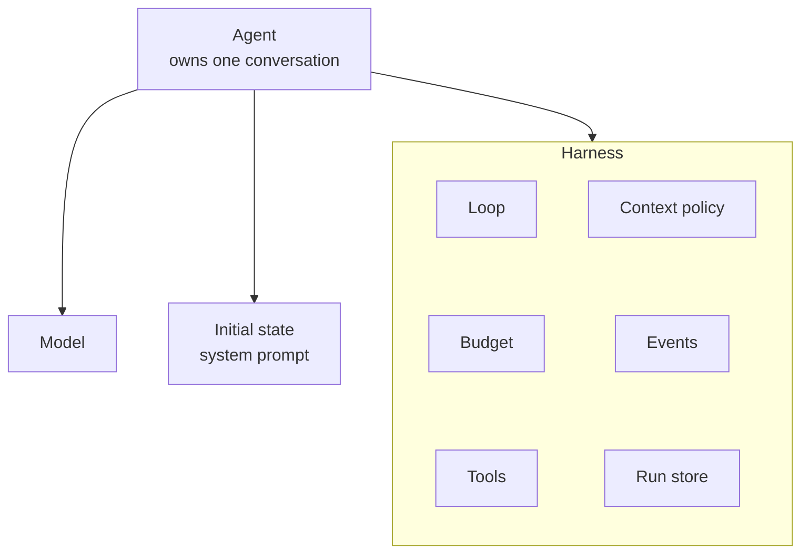

# Agent

An agent is a model plus a harness, with a system prompt to start from. It owns one conversation and continues it on every run, so the same agent can be given several tasks in a row and remember the earlier ones.



Each box is a block that can be replaced by another implementation of the same interface.

## The interface

```python
class Agent(ABC):
    @property
    def state(self) -> RunState: ...  # the conversation, read-only by convention

    @property
    def inbox(self) -> Inbox: ...  # content put here during a run joins the conversation before the next model call

    async def run(self, task: str | list[ContentBlock], signal: AbortSignal) -> RunOutcome: ...
```

`run()` adds the task to the conversation as a user message and runs the loop until it stops. The task is text, or content blocks such as an image with a question.

## Composed agent

`ComposedAgent` is built from the blocks:

```python
ComposedAgent(
    model: Model,
    harness: Harness | None = None,  # default: StandardLoop and a 25-step limit per run
    initial_state: InitialState | None = None,  # default: no system prompt
    session_budget: Budget | None = None,  # default: no limit across runs
    state: RunState | None = None,  # a saved state to resume
)
```

A model is the only required part. Every run gets a fresh child of the session budget, limited by the harness budget, so the harness budget is the limit of each run and the session budget the limit of all runs together. Runs of one agent take turns: a second `run()` waits until the first one is over, so the conversation never interleaves.

## Several runs, one conversation

```python
--8<-- "docs/examples/agent.py:runs"
```

Output:

```text
Nice to meet you, Ada.
Your name is Ada.
end_turn 4 messages
```

The second run continued the conversation of the first. A fresh conversation takes a fresh agent.

## Lifecycle

Blocks that hold connections or processes, such as a model's HTTP client or a tool's server process, are resources with `start()` and `aclose()`. Using the agent in `async with` starts its model and tools before the first run and closes them after the last. Both methods do nothing by default and may be called more than once, because blocks can be shared between agents.

## Cancellation

A run is cancelled by setting its signal, an `asyncio.Event`. The loop checks it before every step, the model stops waiting for a response, and every sub-agent started by the run shares the same signal, so the whole tree stops.

```python
--8<-- "docs/examples/agent.py:cancel"
```

Output:

```text
cancelled
```

A cancelled run leaves a valid conversation behind: a tool call cut short still gets a result, so the agent can take the next task.

## Inbox

Content can join a run while it is going: a message typed by the user, or the result of a background task. `agent.inbox.put(content)` queues it, and the loop adds it to the conversation before the next model call. When the model has just finished its turn and something is waiting, the run goes on instead of ending.

## Resuming

An agent created with `state=` continues a saved conversation. The [State and run store](state.md#resuming-a-run) page shows the whole cycle of saving and resuming a run.
