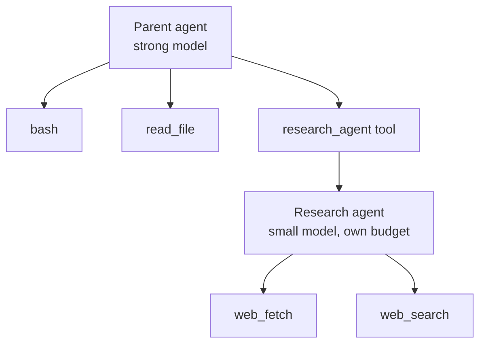
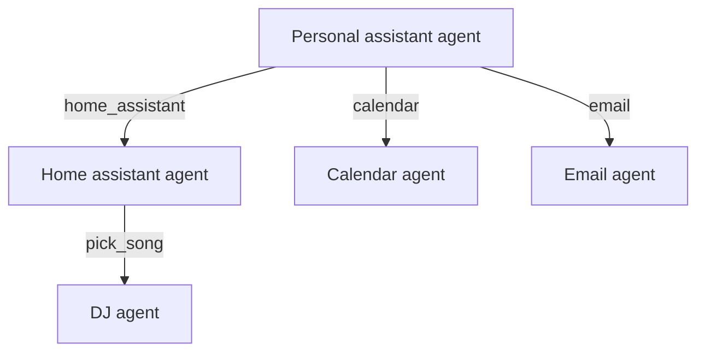

# Composition

An agent can be used as a tool by another agent. The tool's handler starts a new run of the inner agent with a fresh conversation, and returns its final answer as the tool result. For the outer agent, the inner one is a tool like any other.



This gives sub-agents, parallel sub-tasks, recursion and a different model for each sub-agent, with no new concepts: only a tool whose handler runs a harness.

## What a sub-agent gets

- A fresh conversation, started from its own initial state, with the task as the first user message. It does not see the parent's conversation, so the task must say everything it needs to know.
- Its own budget: a child of the parent's budget for the current run. Its limit is the sub-agent's harness budget, it can never exceed what the parent has left, and everything it spends is charged to the parent.
- The parent's signal, so cancelling the parent cancels the sub-agent.
- A `parent_id` in its state, linking it to the run that started it.

The parent receives the sub-agent's final answer as the tool result.

## spawn_agent

`SpawnAgentTool` is the general form: a tool named `spawn_agent` that takes a task and runs it in a fresh sub-agent made of a model, a harness and an initial state. It is concurrent, so the model can start several sub-agents in one turn and they run in parallel.

```python
--8<-- "docs/examples/composition.py:spawn"
```

Output:

```text
[lead_agent] → spawn_agent(task='Read the groceries note.')
[lead_agent] → spawn_agent(task='Read the ideas note.')
[sub_agent] → read_note(title='groceries')
[sub_agent] ← read_note: milk, eggs, coffee
[sub_agent] → read_note(title='ideas')
[sub_agent] ← read_note: give every sub-agent its own budget
[sub_agent] ■ done (end_turn)
[lead_agent] ← spawn_agent: groceries: milk, eggs, coffee
[sub_agent] ■ done (end_turn)
[lead_agent] ← spawn_agent: ideas: give every sub-agent its own budget
[lead_agent] ■ done (end_turn)
groceries: milk, eggs, coffee | ideas: give every sub-agent its own budget
steps in the whole tree: 6
```

The two sub-agents ran at the same time, so their lines interleave. The session budget counted all six model calls: two of the lead agent and two of each sub-agent.

!!! note "A parent's budget covers its sub-agents"
    The sub-agents' steps are charged to the lead agent's run budget too. A parent that delegates needs a budget large enough for its own steps and those of its sub-agents.

## Blueprints

A `Blueprint` describes an agent once: its name, a description, the model, the harness and the initial state. The same blueprint can then run on its own or serve as a tool:

```python
@dataclass
class Blueprint:
    name: str
    description: str
    model: Model
    harness: Harness
    initial: InitialState = InitialState()

    def agent(self, session_budget: Budget | None = None) -> Agent: ...  # a standalone agent
    def as_tool(self, name: str | None = None) -> AgentTool: ...  # the same agent as a tool
    def tree(self) -> str: ...  # the composition as a tree
```

`as_tool()` returns an `AgentTool`: a `SpawnAgentTool` named after the blueprint, whose description tells the model what the agent does. `tree()` prints the whole composition, with agent tools expanded recursively.

```python
--8<-- "docs/examples/composition.py:blueprint"
```

Output:

```text
editor [playbook:editor]: writes digests of the notes.
  harness: StandardLoop, budget steps=5, TranscriptBus
  tools: read_note
  └─ note_reader [playbook:reader]: reads notes and reports what they say.
       harness: StandardLoop, budget steps=3, TranscriptBus
       tools: read_note
[editor] → note_reader(task='Read the ideas note.')
    [note_reader] → read_note(title='ideas')
    [note_reader] ← read_note: give every sub-agent its own budget
    [note_reader] ■ done (end_turn)
[editor] ← note_reader: ideas: give every sub-agent its own budget
[editor] ■ done (end_turn)
Digest. ideas: give every sub-agent its own budget
```

`TranscriptBus` indents the lines of an agent tool by how deep it is nested, so the transcript of a tree reads as a tree.

## Composing further

Composition nests to any depth. A home assistant agent can use a DJ agent to pick songs, and the home assistant can in turn become a tool of a personal assistant, next to a calendar agent and an email agent:



Each agent in the tree has its own model, tools and limits, and the budget of the top agent bounds them all. The [home assistant tutorial](../tutorials/home-assistant.md) builds the lower half of this tree.
