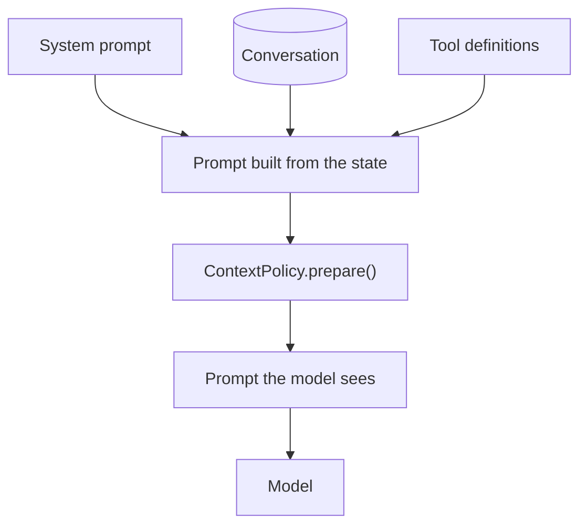

# Context policy

Before every model call, the loop builds a prompt from the state: the system prompt, the conversation and the definitions of the available tools. The context policy then decides what the model actually sees on this call. It can cut large tool outputs, add the current time or the state of the world, inject instructions for the kind of work at hand, mark cache breakpoints or hide tools that do not apply.

The policy changes only the prompt and leaves the state as it is. The conversation is stored whole, and what each call sees is decided anew.



## The interface

```python
class ContextPolicy(ABC):
    async def prepare(self, state: RunState, prompt: Prompt, model: Model) -> Prompt: ...

    def needs_compaction(self, state: RunState, model: Model) -> bool:
        return False

    async def compact(self, state: RunState, model: Model, budget: Budget, signal: AbortSignal) -> None: ...
```

`prepare()` gets the prompt built from the state and returns a changed copy. It receives the model too, so it can adapt to the model's capabilities, for example to its context window.

`needs_compaction()` and `compact()` are optional. They handle a conversation that grows too long: before each step the loop asks `needs_compaction()`, and if it returns true, `compact()` rewrites `state.messages` for good, for example by replacing old history with a summary written by the model. Model calls made while compacting are charged to the budget it receives. Unlike `prepare()`, compaction does change the state, and the [event bus](events.md) can deny it.

## A policy

A policy that adds the list of notes to the system prompt of every call:

```python
--8<-- "docs/examples/context_policy.py:policy"
```

To show its effect, a model that prints the system prompt it receives:

```python
--8<-- "docs/examples/context_policy.py:model"
```

```python
--8<-- "docs/examples/context_policy.py:run"
```

Output:

```text
model sees: 'You manage notes.\n\nNotes available: groceries, ideas'
model sees: 'You manage notes.\n\nNotes available: groceries, ideas, travel'
state keeps: 'You manage notes.'
```

The model always sees the current list, including the note added between the runs, while the stored system prompt stays as it was written. Information added this way never piles up in the conversation.

## Stacking policies

A harness has one policy. Several policies are combined by wrapping: a policy takes an inner policy, lets it prepare the prompt first and then adds its own changes. `LiveStatusPolicy` follows this pattern with its `inner` argument.

## Ready blocks

`LiveStatusPolicy`: adds the current state of simulated devices to the last message of every call. It is used by the toy agents in the repository's `examples/` directory.

The demo agent in `examples/` has `TruncatingContextPolicy`, which cuts long tool outputs in what the model sees while the state keeps them whole.
