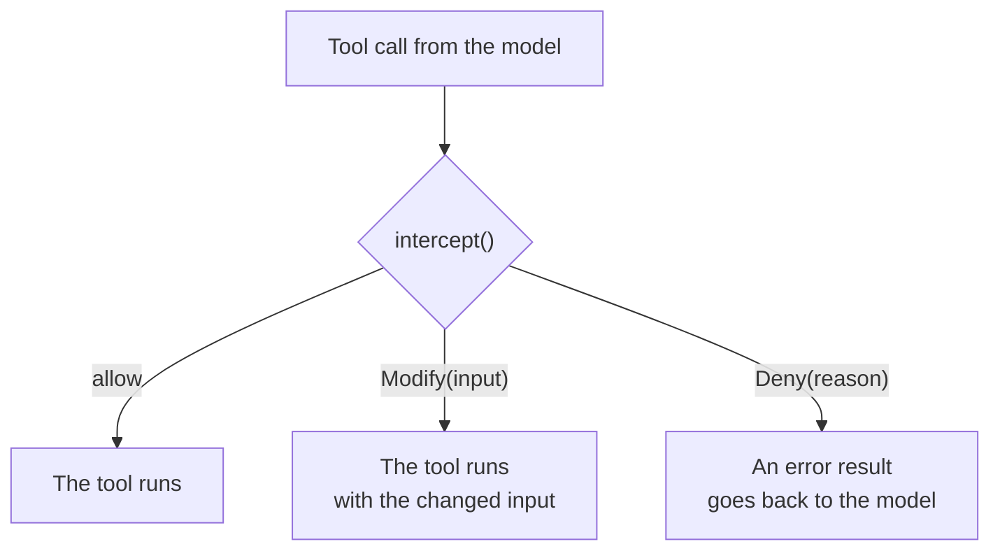

# Events

The loop reports every fixed point of a run as an event: a task arriving, a model call, a response, a tool call and its result, the end of the run. Blocks attached to the event bus observe these events for logging, tracing or a user interface.

Some events can also be intercepted: allowed, denied or changed before they take effect. Permission checks, human approval and safety limits are built this way, outside the loop and outside the tools.

## The interface

```python
class EventBus(ABC):
    def emit(self, e: LoopEvent) -> None: ...  # observation: logging, tracing, UI
    async def intercept(self, e: InterceptableEvent) -> Decision: ...  # permissions, approval, hooks


Decision = Literal["allow"] | Deny | Modify


@dataclass
class Deny:
    reason: str = ""


@dataclass
class Modify:
    value: Any
```

`emit()` is called for every event and returns nothing. `intercept()` is called at the points where a decision is possible, and may wait, for example for a human to approve a call.

## Events

Every event is a dictionary with a `type` and the `run_id` of the run it belongs to:

- `prompt`: a task is about to be added to the conversation, with its `content`.
- `request`: the loop is about to call the model, with the number of `messages`.
- `delta`: a piece of the response as the model produces it: text, thinking or tool input.
- `response`: the model answered, with the `stop_reason` and the `usage`.
- `tool_call`: a tool is about to run, with the `call_id`, the tool `name` and its `input`.
- `tool_result`: a tool ran, with its `content` and `is_error`.
- `stop`: the model ended its turn.
- `compact`: the context policy is about to compact the conversation.
- `done`: the run is over, with the `reason`.

## Interception points

What a decision means depends on the event:

- `prompt`: `Deny` blocks the run and the reason is returned as the answer; `Modify` replaces the task's content.
- `tool_call`: `Deny` answers the call with an error that carries the reason; `Modify` replaces the input.
- `tool_result`: `Deny` replaces the result with an error; `Modify` replaces the content.
- `stop`: `Deny` keeps the run going, and the reason becomes the next message to the model.
- `compact`: `Deny` skips the compaction.



A denied call is not executed. The model receives an error result with the reason and can tell the user or try something else.

## A bus

A bus that prints tool calls and results, refuses tasks about passwords and lower-cases note titles:

```python
--8<-- "docs/examples/events.py:bus"
```

```python
--8<-- "docs/examples/events.py:run_bus"
```

Output:

```text
Note the trip.
  call    write_note({'title': 'Trip', 'text': 'book the train'})
  result  saved trip (error: False)
  -> end_turn: saved trip
Store my password.
  -> blocked: tasks about passwords are not accepted
['groceries', 'trip']
```

The `tool_call` event still shows the input the model asked for, `Trip`, while the tool received the changed input and saved `trip`. The second task never reached the model.

## Guard rules

`GuardBus` wraps another bus and adds rules on tool calls. Events pass through to the inner bus unchanged, and each tool call must get past every rule. A rule is a function that takes the tool call event and returns `None` for no objection, or a decision with an explanation:

```python
--8<-- "docs/examples/events.py:guard"
```

Output:

```text
[notes_agent] → delete_note(title='groceries')
[notes_agent] ⚑ guard: delete_note denied, notes are never deleted
[notes_agent] ✗ delete_note: the call to delete_note was denied: notes are never deleted
[notes_agent] ■ done (end_turn)
[notes_agent] → write_note(title='essay', text='word word word word word word word word word word word word w…
[notes_agent] ⚑ guard: write_note denied, the note is too long
[notes_agent] ✗ write_note: the call to write_note was denied: notes are limited to 100 characters
[notes_agent] ■ done (end_turn)
```

`forbid(tool, reason)` denies a tool outright. `clamp(tool, field, lo, hi)` keeps a numeric input within bounds by changing the call instead of denying it; the [research team tutorial](../tutorials/research-team.md) uses it. Rules see the changes made by earlier rules, and the first denial ends the check.

## Ready blocks

`TranscriptBus`: prints tool calls and results as a tree, indented by how deep the agent is nested.

`GuardBus`, `forbid()` and `clamp()`: safety rules on tool calls, around any other bus.

The demo agent in the repository's `examples/` directory has `LoggingEventBus`, which logs every event to stderr and denies tools by name.
