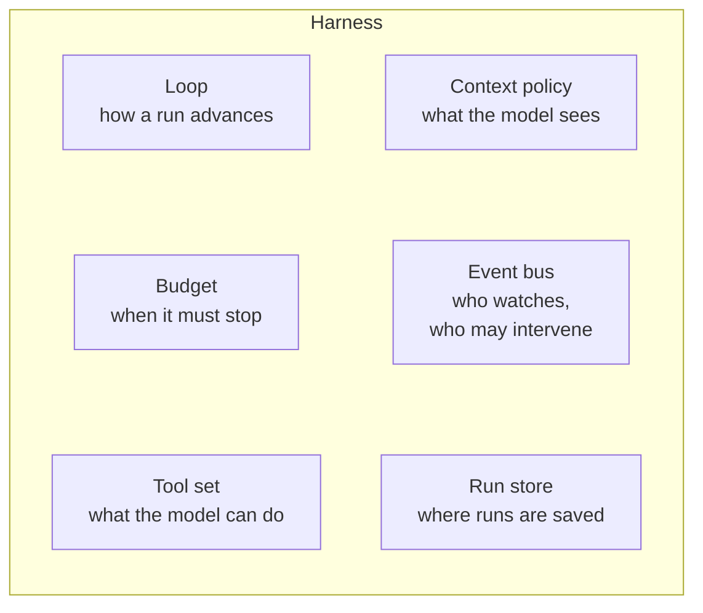

# Harness

The harness is everything around the model in one object: the loop, the budget, the tools, the context policy, the event bus and the run store.



## The interface

```python
@dataclass
class Harness:
    loop: Loop
    budget: Budget
    tools: ToolSet | None = None  # none: the model can only answer in text
    policy: ContextPolicy | None = None  # none: the model sees the conversation as it is
    events: EventBus | None = None  # none: nothing observed, every tool call allowed
    store: RunStore | None = None  # none: nothing saved

    async def run(self, state: RunState, model: Model, signal: AbortSignal, inbox: Inbox | None = None) -> RunOutcome: ...
```

Only the loop and the budget are required. Each optional part has a plain meaning when it is left out, so a minimal agent needs no more than a loop and a budget.

`run()` hands its parts to the loop as one [`RunContext`](loop.md#the-interface), together with the model and the signal. The harness does not hold the model: the same harness can serve agents with different models.

## A harness with every part

```python
--8<-- "docs/examples/harness.py:harness"
```

## One harness, two agents

The model is not part of the harness, so one harness can serve several agents:

```python
--8<-- "docs/examples/harness.py:agents"
```

Output:

```text
[notes] → read_note(title='groceries')
[notes] ← read_note: milk, eggs, coffee
[notes] ■ done (end_turn)
milk, eggs, coffee
[notes] → read_note(title='groceries')
[notes] ← read_note: milk, eggs, coffee
[notes] ■ done (end_turn)
Your groceries list says: milk, eggs, coffee. Anything else?
2 runs saved
```

Both agents use the same tools, policy, event bus and store, and each run gets its own fresh budget from the harness budget. Only the model differs.

## Lifecycle

`start()` starts the tools before the first run and `aclose()` closes them after the last, for tools that hold connections or processes. The [agent](agent.md) calls both when it is used in `async with`.
