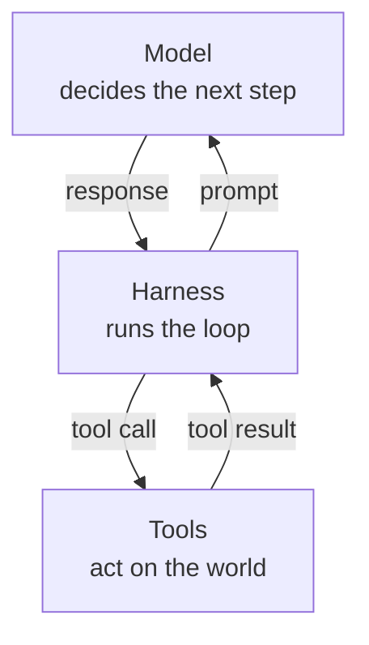
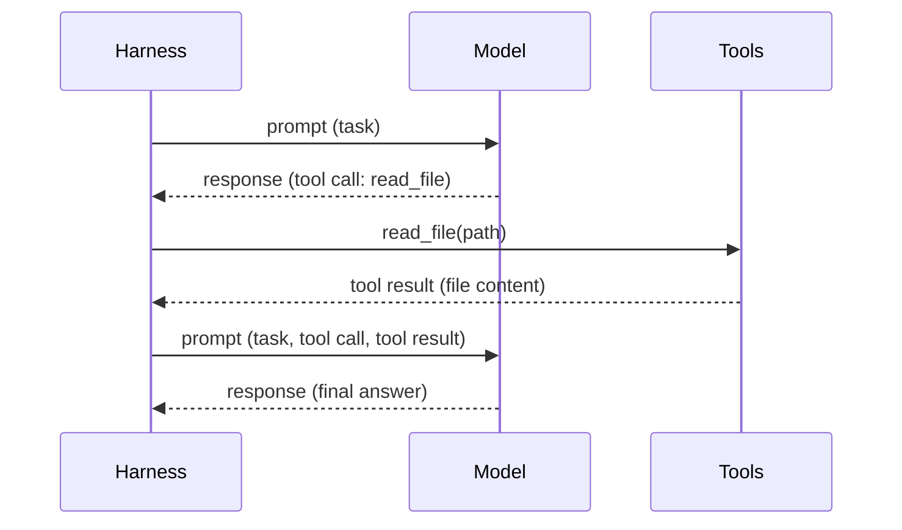
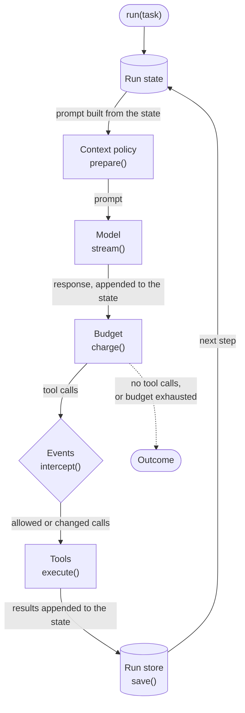

# Concepts

This section describes every building block of an agent, one page each. The pages are ordered so that each one uses only the blocks introduced before it.

## An agent is a model run in a loop

Three parts do the work. The model decides the next step. The harness runs the loop. The tools act on the world: they run commands, read files, call services or operate devices.



They exchange four kinds of data:

- A prompt, sent by the harness to the model: everything the model must know to decide the next step.
- A response, returned by the model: text, tool calls or both.
- A tool call, passed by the harness to a tool: the name of the tool and its input, as requested by the model.
- A tool result, returned by the tool: the output or an error.

A typical run takes several rounds. The model only asks for actions, and the harness carries them out:



## The building blocks

[Messages](messages.md): the data that flows between the blocks: messages, prompts and responses.

[Model](model.md): turns a prompt into a response. Behind the interface: a protocol adapter, a transport, an endpoint and a scheduler.

[Tools](tools.md): what an agent can do beyond producing text, and tool sets that group them.

[State and run store](state.md): the conversation of a run as plain data, and where it is saved.

[Context policy](context-policy.md): decides what the model sees on each call.

[Loop](loop.md): advances a run one model call at a time until a stop condition.

[Budget](budget.md): the stop condition in steps, tokens, cost and time, shared down a tree of agents.

[Events](events.md): every step of the loop reported as an event, and tasks, tool calls and results intercepted before they take effect.

[Harness](harness.md): all of the above, except the model, in one object.

[Agent](agent.md): a model plus a harness, owning one conversation.

[Composition](composition.md): agents used as tools of other agents.

## How the blocks work together

One step of the loop passes through every block:



1. The agent adds the task to its conversation and starts the loop.
2. The loop builds a prompt from the state and the tool definitions, and the context policy adjusts it.
3. The model returns a response. The loop appends it to the state and charges its usage to the budget.
4. If the response contains tool calls, the event bus may allow, deny or change each of them, the loop executes the allowed ones and appends the results to the state.
5. The run store saves the state, and steps 2 to 5 repeat until a stop condition is reached.
6. The loop returns the outcome: the reason the run stopped, the final message and the state.

## Principles

- Each block exposes a narrow interface and depends only on the shared data and on the interfaces of other blocks, never on their implementations.
- Each block changes for one reason: the model when models or where they run change, the loop when agent behaviour changes, the tools when capabilities change.
- Blocks exchange data only, and the state of a run is data. Every exchange can be logged, stored and replayed.
- Every block can be replaced, and tested on its own against fakes of the blocks around it.

## Interfaces and implementations

The interfaces are technology agnostic: any language with types and interfaces can express them. In the Python implementation they live in the `modular_agents.interfaces` package, one module per concept, with no implementations. The ready building blocks that implement them live in `modular_agents.composites`. An agent is composed from those blocks, from blocks written for the agent, or from both. The code on these pages imports from both packages, for example:

```python
from modular_agents.interfaces.tools import Tool  # an interface
from modular_agents.composites.loop.loop import StandardLoop  # a ready building block
```
