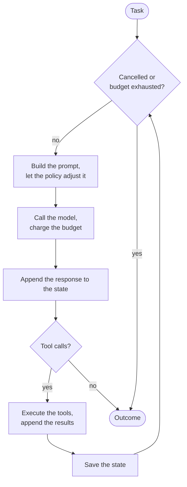

# Loop

The loop advances the state of a run one step at a time. One step builds a prompt, calls the model and appends the response to the state. If the response contains tool calls, the loop executes them, appends the results and takes another step. Otherwise the run ends.



## The interface

```python
class Loop(ABC):
    async def run(self, state: RunState, ctx: RunContext) -> RunOutcome: ...


@dataclass
class RunContext:
    model: Model
    budget: Budget
    signal: AbortSignal
    tools: ToolSet | None = None
    policy: ContextPolicy | None = None
    events: EventBus | None = None
    store: RunStore | None = None
    inbox: Inbox | None = None


@dataclass
class RunOutcome:
    reason: str  # a stop reason, "budget_exhausted", "cancelled" or "blocked"
    final: Message  # the last message of the model
    state: RunState
```

The loop gets the state to advance and a `RunContext` with every other block it works with. The context is built for each run, so the loop never depends on the [harness](harness.md) or the [agent](agent.md) that called it.

## Stop conditions

A run ends when:

- The model finishes its turn (`end_turn`), is cut off (`max_tokens`) or refuses (`refusal`).
- The budget is exhausted (`budget_exhausted`): steps, tokens, cost or time.
- The run is cancelled from outside (`cancelled`).
- The event bus blocks the task before the run starts (`blocked`).

The budget is required, so every run has a guaranteed end, even when the model never stops calling tools.

## The standard loop

`StandardLoop` implements the steps above, and a little more:

- It streams every model call and reports the pieces to the event bus as `delta` events.
- It runs consecutive concurrent tool calls in parallel, and every other call alone, in the order the model asked.
- It passes every tool call and every tool result through the event bus, which may allow, deny or change them.
- It reports a failing tool to the model as an error result instead of raising.
- It adds content waiting in the agent's inbox before the next model call.
- It saves the state to the run store after every step.
- When the model ends its turn, it asks the event bus once more: a stop hook can deny the stop and give the model a reason to continue.

## Running the loop directly

Agents normally call the loop for their users, but the loop is usable on its own. It needs a state and a context:

```python
--8<-- "docs/examples/loop.py:setup"
```

`run()` takes steps until the run stops. `step()` takes one step and returns an outcome only when the run is over, so a run can be followed step by step:

```python
--8<-- "docs/examples/loop.py:steps"
```

Output:

```text
after step 1: 3 messages
stopped: end_turn

user: text 'What is on the groceries list?'
assistant: tool_call read_note({'title': 'groceries'})
user: tool_result 'milk, eggs, coffee'
assistant: text 'Buy milk, eggs, coffee.'
```

The first step called the model, which asked for `read_note`, and executed the call. The second step called the model again, which answered, so the step returned the outcome.

## Writing a loop

A different loop is another implementation of the same interface. A loop that plans before it acts, one that asks a human to approve every step, or one that runs a fixed sequence of tool calls without a model all fit, and the rest of the agent stays the same.
