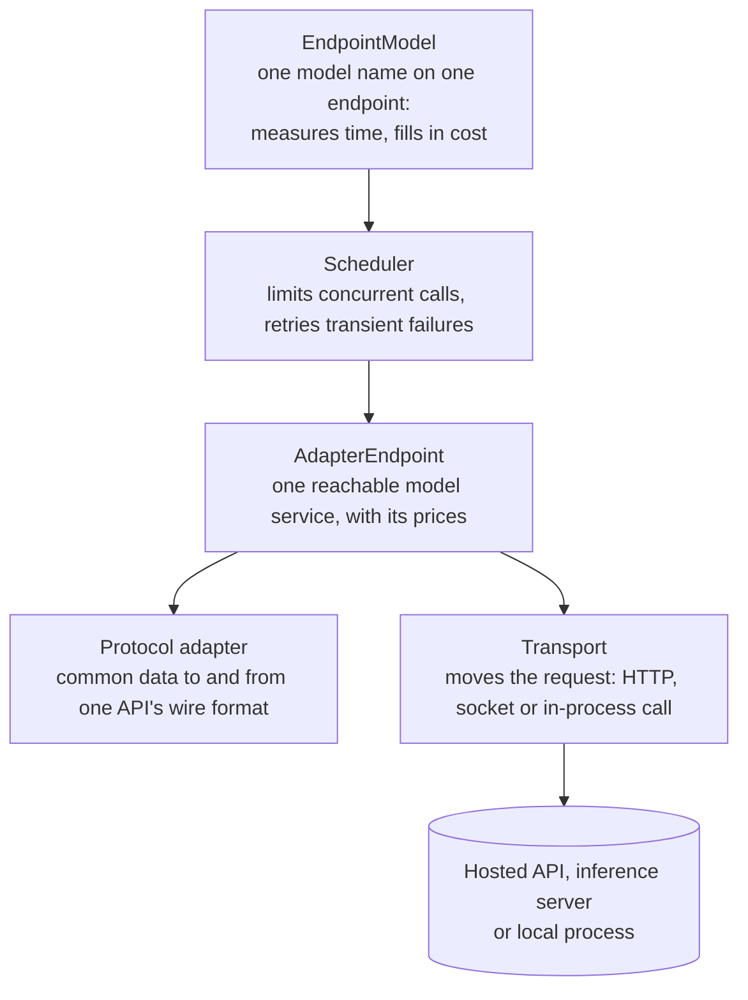

# Model

The model turns a prompt into a response. It keeps no memory between calls, so everything it needs to know must be in the prompt.

A model can run in different places: on a provider's servers behind a hosted API, on an inference server in the local network, in a separate process on the same machine, or inside the agent's own process. The rest of the agent does not know where the model runs. It only sees this interface.

## The interface

```python
class Model(ABC):
    @property
    def ref(self) -> str: ...  # the model's name, e.g. "claude-haiku-5-5"

    async def complete(self, prompt: Prompt, signal: AbortSignal) -> ModelResponse: ...

    def stream(self, prompt: Prompt, signal: AbortSignal) -> AsyncIterator[ModelEvent]: ...

    def capabilities(self) -> Capabilities: ...
```

`complete()` waits for the whole response. `stream()` yields the response as it is produced (text, thinking and tool input in pieces) and always ends with a `response_complete` event that carries the whole response. The [loop](loop.md) streams every call and passes the pieces to the [event bus](events.md), so a user interface can show the answer while it is being written.

`signal` is an `asyncio.Event`. Setting it cancels the call, and the [agent](agent.md) uses one signal for a whole run, including its sub-agents.

`capabilities()` describes what the model supports: the size of its context window, tool calling, parallel tool calls, thinking, image input, structured output and prompt caching.

Like every block that holds connections, a model is a resource with `start()` and `aclose()`. Both do nothing by default, and the agent calls them when it is used in `async with`.

## A model from scratch

Any class that implements the interface is a model. This one answers with the task in capitals:

```python
--8<-- "docs/examples/model_custom.py:model"
```

It can be called directly or serve as the model of an agent:

```python
--8<-- "docs/examples/model_custom.py:use"
```

Output:

```text
[{'type': 'text', 'text': 'HELLO'}] end_turn
A MODEL IS JUST AN INTERFACE
```

## Scripted model

`PlaybookModel` follows written playbooks instead of thinking. It picks the playbook whose keyword appears in the task and plays one turn per model call. A turn is `call(...)` for one tool call, a list of calls for several calls in one turn, or `say(...)` for the answer. `say()` takes a string, or a function that builds the answer from the results of the tool calls so far.

```python
--8<-- "docs/examples/model_playbook.py:playbooks"
```

```python
--8<-- "docs/examples/model_playbook.py:run"
```

Output:

```text
Please greet me. -> Hello!
Throw two dice. -> You rolled 4 and 4.
Tell me a joke. -> I only know playbooks for: greet, dice.
```

The playbook model is stateless: it reads its position in the playbook from the conversation, so one instance can serve any number of agents. It is deterministic and free, which makes it the model for tests, for demos and for most examples on this site.

!!! note
    `call(name, **input)` takes the tool input as keyword arguments, so a tool input cannot itself be called `name`.

## Behind the interface

A model that calls a remote API is made of replaceable parts:



Moving an agent to another provider, or to another place where the model runs, changes only these parts.

### Protocol adapter

A protocol adapter converts between the common data of the [Messages](messages.md) page and the wire format of one API. It is a pure data-to-data conversion: it performs no I/O and holds no credentials, so it can be tested without network access. Supporting another API takes another adapter, and the rest of the agent is unchanged.

```python
class ProtocolAdapter(ABC):
    def encode(self, req: ModelRequest, caps: Capabilities) -> dict: ...
    def decode(self, res: dict) -> ModelResponse: ...
    def decode_stream(self, chunks: AsyncIterator[dict]) -> AsyncIterator[ModelEvent]: ...
```

`AnthropicAdapter` implements it for the Anthropic Messages API:

```python
--8<-- "docs/examples/model_anthropic.py:adapter"
```

Output, the request body and the decoded response:

```text
{
  "model": "claude-haiku-5-5",
  "max_tokens": 1000,
  "system": "You are a helpful assistant.",
  "messages": [
    {
      "role": "user",
      "content": [
        {
          "type": "text",
          "text": "Say hello."
        }
      ]
    }
  ]
}
ModelResponse(content=[{'type': 'tool_call', 'id': 'toolu_01', 'name': 'read_file', 'input': {'path': 'notes.txt'}}], stop_reason='tool_use', usage={'input_tokens': 410, 'output_tokens': 52, 'cost_usd': 0.0, 'elapsed_ms': 0.0, 'cache_read_tokens': 0, 'cache_write_tokens': 0})
```

The adapter also converts images and documents, keeps the original wire form of thinking blocks so that they can be sent back unchanged, and decodes streamed responses.

### Transport

A transport sends a request body to one address and returns the response body, or a stream of chunks. It holds the address and the request headers, including credentials, and does not interpret the body. `HttpTransport` posts JSON over HTTP and reads streams as server-sent events. It marks rate limits, overload and network failures as retryable, so the scheduler can retry them.

```python
class Transport(ABC):
    async def send(self, req: dict, signal: AbortSignal) -> dict: ...
    def stream(self, req: dict, signal: AbortSignal) -> AsyncIterator[dict]: ...
```

### Endpoint and scheduler

An endpoint is one reachable model service. `AdapterEndpoint` joins a protocol adapter and a transport, and holds the service's prices, so it can compute the cost of each call. `EndpointModel` implements the `Model` interface for one model name on one endpoint: it runs each call through a scheduler, measures its duration and fills in its cost.

`SemaphoreScheduler` limits the number of concurrent calls per endpoint and retries transient failures with exponential backoff. Models that share an endpoint's rate limits should share one scheduler.

```python
--8<-- "docs/examples/model_anthropic.py:endpoint"
```

```python
--8<-- "docs/examples/model_anthropic.py:call"
```

`AnthropicModel` builds all of these parts in one line. It reads the API key from `ANTHROPIC_API_KEY` when none is given, and accepts the same `params`, `caps` and `scheduler`:

```python
--8<-- "docs/examples/model_anthropic.py:shortcut"
```

`AnthropicModel` has no prices, so it reports a cost of 0. An `EndpointModel` built on an endpoint with prices, as above, reports the real cost of every call, and a [budget](budget.md) can then limit spending in dollars.

## Ready blocks

`AnthropicModel`: Claude through the Anthropic Messages API.

`EndpointModel`, `AdapterEndpoint`, `AnthropicAdapter`, `HttpTransport` and `SemaphoreScheduler`: the parts behind it, for other prices, endpoints or limits.

`PlaybookModel`: a scripted model for tests and offline runs.

The full definitions are in the [API reference](../reference/interfaces.md#model).
