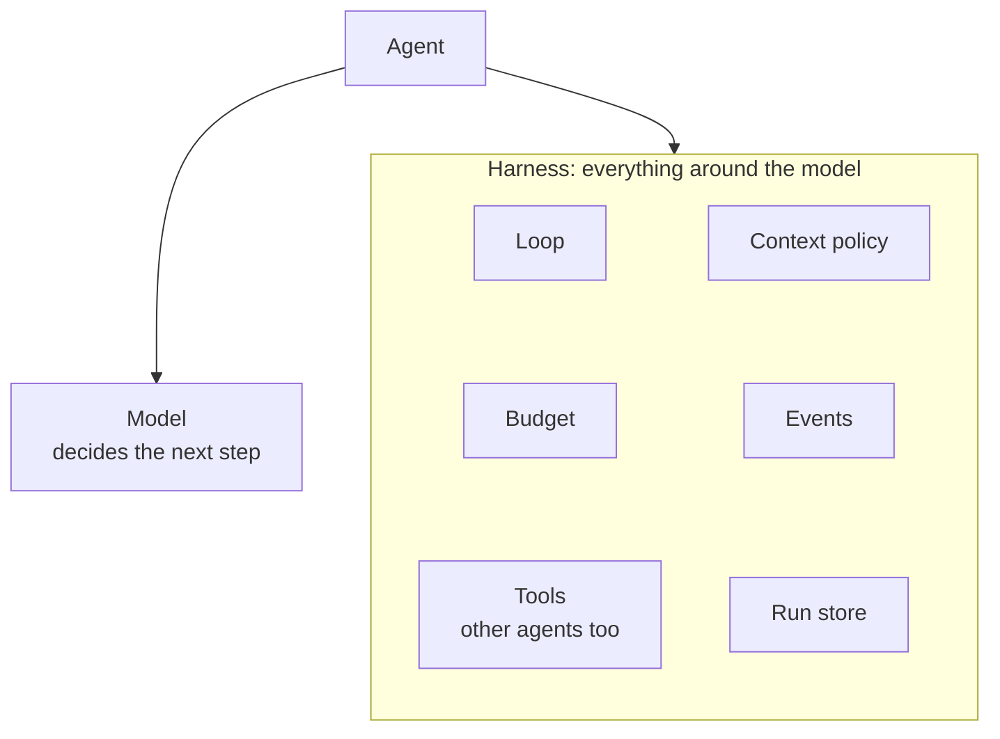

# modular-agents

A modular architecture for LLM agents: technology-agnostic building blocks with defined interfaces, and a reference implementation in Python.

## The idea

An agent is a model run in a loop. The model reads the conversation so far and decides the next step: answer, or ask for a tool to be used. The harness runs the loop: it sends the conversation to the model, executes the requested tools, adds the results to the conversation and asks the model again.

Everything around this loop is a separate building block behind its own small interface: how much an agent may spend, what it is allowed to do, what the model sees on each call and what gets saved. A new agent is made by replacing, adding or removing blocks. Swapping a hosted model for a local one, giving an agent a new tool or putting a permission check in front of its tools is each a change to one block, with the rest of the agent untouched.

Because an agent is only a composition of blocks, one agent can be a tool of another. The parent sees an ordinary tool, the child runs in its own fresh conversation, and its spending is charged to the parent's budget. Agents nested this way form a tree that can be printed, limited and observed as a whole.



## The building blocks are small

Most interfaces have one to three methods. A tool, for example, is a definition the model sees and a method that does the work:

```python
class Tool(ABC):
    @property
    def definition(self) -> ToolDefinition: ...  # name, description, input schema
    async def execute(self, input: dict, ctx: ToolContext | None = None) -> ToolOutput: ...
```

An agent is a model plus a harness, composed in one expression:

```python
--8<-- "docs/examples/first_agent.py:agent"
```

## Technology agnostic

The interfaces are not tied to a language, a model provider or a runtime. The blocks exchange plain data only, so every exchange can be logged, stored and replayed, and every block can be tested on its own against fakes of its neighbours. This site describes the architecture through its Python implementation, the `modular-agents` package, whose `interfaces` package holds the interfaces and whose `composites` package holds ready building blocks that implement them.

## Where to go next

[Getting started](getting-started.md): install the package and run a first agent, offline and on Claude.

[Concepts](concepts/index.md): every building block, one page each, in the order they depend on each other.

[Tutorials](tutorials/research-team.md): two complete agents built step by step.

[Examples](examples.md): the agents in the repository's `examples/` directory.

[API reference](reference/interfaces.md): the full interfaces and building blocks, generated from the code.
