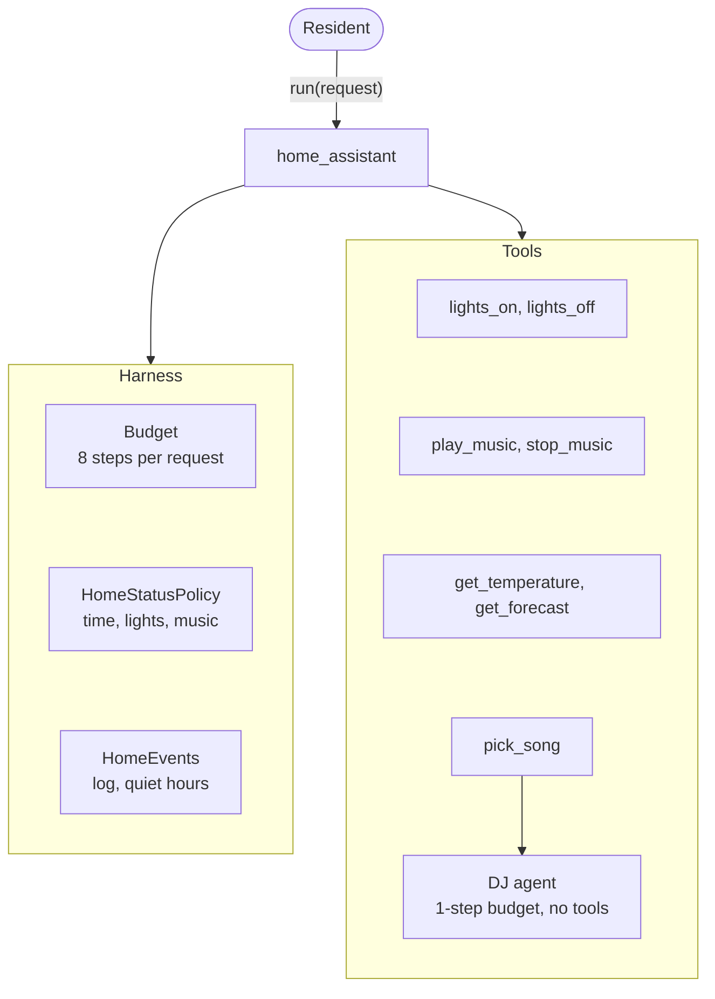
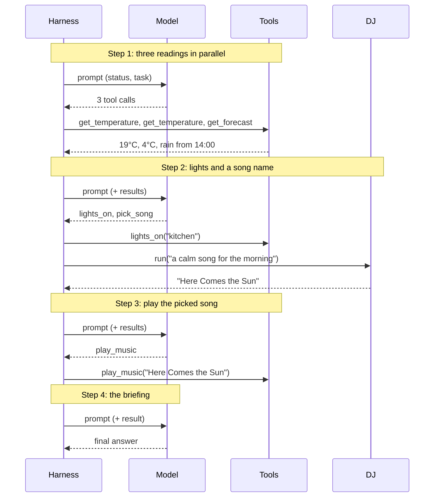

# A home assistant

This tutorial builds an agent that controls a home on request. It turns lights on and off, plays music, reads the temperature inside and outside, and checks the weather forecast. Unlike the [research team](research-team.md), it writes a block of almost every kind for itself: its own tools, a context policy that shows the model the state of the home, and an event bus that logs every action and keeps the quiet hours. A second agent, the DJ, picks songs and serves as one of its tools.

The complete code is [`docs/examples/home_assistant.py`](https://github.com/frycz/modular-agents/blob/main/docs/examples/home_assistant.py).

## What it does

A request from a resident goes in. Actions in the home and a reply come out. Four kinds of requests show the parts at work:

- A simple command takes one tool call: "Turn off the living room lights."
- A question needs several readings before the answer: "Should I open the window?"
- A request by mood needs the DJ first, because `play_music` takes a song name: "Play something calm."
- A request at night is blocked by a guard rule: "Play Thunderstruck" at 23:10.

## Components

- Model: any model. Offline, a playbook model; on Claude, Claude Haiku 5.5.
- System prompt: the role of the assistant and its morning routine.
- Tools: `lights_on`, `lights_off`, `play_music`, `stop_music`, `get_temperature`, `get_forecast`, and `pick_song`, which is the DJ agent.
- Context policy: `HomeStatusPolicy`, which adds the time and the state of the home to every prompt.
- Events: `HomeEvents`, a log of every tool call and result, with one rule: no music from 22:00 to 07:00.
- Budget: 8 steps per request.



## 1. The home

The example runs without real devices. `Home` simulates them: the lights in each room, the song that is playing, the two thermometers and the forecast. It also holds the current time, so a whole day runs in a moment. The tools, the policy and the event bus all read or change the same `Home`.

```python
--8<-- "docs/examples/home_assistant.py:home"
```

## 2. The prompts

The system prompts of the assistant and of the DJ. The assistant's prompt also defines the morning routine, so a plain "Good morning." is enough to start it.

```python
--8<-- "docs/examples/home_assistant.py:prompts"
```

## 3. The tools

Each tool is a definition and a handler that acts on the home. The `enum` lists in the input schemas tell the model the only valid rooms, places and days. The sensor tools only read, so they are concurrent and the loop runs the readings in parallel.

```python
--8<-- "docs/examples/home_assistant.py:tools"
```

## 4. The context policy

`HomeStatusPolicy` adds the current time and the state of the home to the system prompt before every model call. The model knows which lights are on without calling a tool, and the status it sees is always current, even between two steps of one run. The status is never stored in the conversation.

```python
--8<-- "docs/examples/home_assistant.py:policy"
```

## 5. The event bus

`HomeEvents` does two jobs. It prints a log line for every tool call and result, and it denies `play_music` during quiet hours. A denied call is not executed: the model receives an error result with the reason, and tells the resident.

```python
--8<-- "docs/examples/home_assistant.py:events"
```

## 6. The composition

The DJ is an agent with no tools and a budget of one step: it reads the request and answers with a song. Turned into a tool named `pick_song`, it joins the home tools in a combined tool set. The whole assistant is one function of the home and two models.

```python
--8<-- "docs/examples/home_assistant.py:compose"
```

## 7. A day in the home

Each request starts a new agent from the blueprint, so every request has a fresh conversation and a fresh 8-step budget, while the home keeps its state between requests.

```python
--8<-- "docs/examples/home_assistant.py:day"
```

Offline, scripted models play the assistant and the DJ. A real model chooses the song to play from the DJ's answer; the script names it in advance.

```python
--8<-- "docs/examples/home_assistant.py:offline"
```

```sh
python docs/examples/home_assistant.py
```

Output:

```text
07:15  user       Good morning.
07:15  tool       get_temperature(where="inside")
07:15  result     19°C
07:15  tool       get_temperature(where="outside")
07:15  result     4°C
07:15  tool       get_forecast(day="today")
07:15  result     cloudy, rain from 14:00 to 18:00, high 8°C
07:15  tool       lights_on(room="kitchen")
07:15  result     The kitchen lights are on.
07:15  tool       pick_song(task="a calm song for the morning")
07:15  result     "Here Comes the Sun" by The Beatles
07:15  tool       play_music(song="Here Comes the Sun")
07:15  result     Playing Here Comes the Sun.
07:15  assistant  Good morning. It is 19°C inside and 4°C outside. Today: cloudy, rain from 14:00 to 18:00, high 8°C. The kitchen lights are on and "Here Comes the Sun" by The Beatles is playing.

13:20  user       Should I open the window?
13:20  tool       get_temperature(where="inside")
13:20  result     19°C
13:20  tool       get_temperature(where="outside")
13:20  result     4°C
13:20  tool       get_forecast(day="today")
13:20  result     cloudy, rain from 14:00 to 18:00, high 8°C
13:20  assistant  It is 19°C inside and 4°C outside. Today: cloudy, rain from 14:00 to 18:00, high 8°C. Better keep it closed.

19:30  user       Turn on the living room lights and play something calm.
19:30  tool       lights_on(room="living room")
19:30  result     The living room lights are on.
19:30  tool       pick_song(task="something calm for the evening")
19:30  result     "Clair de Lune" by Debussy
19:30  tool       play_music(song="Clair de Lune")
19:30  result     Playing Clair de Lune.
19:30  assistant  The living room lights are on and "Clair de Lune" by Debussy is playing.

21:05  user       Turn off all the lights and stop the music.
21:05  tool       lights_off(room="kitchen")
21:05  result     The kitchen lights are off.
21:05  tool       lights_off(room="living room")
21:05  result     The living room lights are off.
21:05  tool       lights_off(room="bedroom")
21:05  result     The bedroom lights are off.
21:05  tool       stop_music()
21:05  result     The music is stopped.
21:05  assistant  All the lights are off and the music is stopped.

23:10  user       Play "Thunderstruck".
23:10  tool       play_music(song="Thunderstruck")
23:10  result     the call to play_music was denied: quiet hours, 22:00 to 07:00
23:10  assistant  I cannot play music now: quiet hours, 22:00 to 07:00.
```

## The morning routine, step by step

The "Good morning." run takes four model calls:



1. The model asks for the three readings at once. They are concurrent, so the loop runs them in parallel.
2. The model turns on the kitchen lights and asks the DJ for a morning song.
3. The model plays the song the DJ picked. This step depends on the result of the previous one.
4. The model has everything it needs and answers with the briefing.

## On Claude

The composition takes its models as arguments. One model object can serve both agents:

```python
--8<-- "docs/examples/home_assistant_claude.py"
```

```sh
export ANTHROPIC_API_KEY=...
python docs/examples/home_assistant_claude.py
```

With a real model the answers vary from run to run, but the guard, the budget and the policy behave exactly as in the offline run.

## Building other agents from the same blocks

Each change below touches one block and leaves the rest of the assistant as it is:

- Replace the model: move the assistant from a hosted API to a model on a home server, so no request leaves the home.
- Remove tools: without `play_music`, `stop_music` and `pick_song`, the assistant controls only the lights and reports the weather.
- Add a tool: `set_thermostat(celsius)` lets the assistant heat the home, behind a `clamp()` rule that keeps the temperature between 16°C and 24°C.
- Replace the rules: a home with a sleeping baby denies `lights_on` for the bedroom after 20:00.
- Compose further: the home assistant becomes a tool of a personal assistant agent, next to a calendar agent and an email agent, as shown on the [Composition](../concepts/composition.md#composing-further) page.
