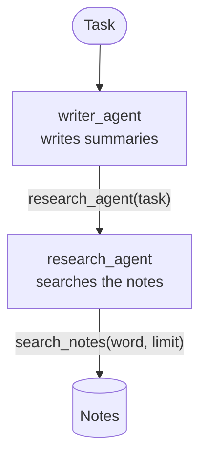

# A research team

This tutorial composes two agents. A research agent searches a set of notes. A writer agent writes summaries, and gets its facts by calling the research agent as a tool. The team runs offline with scripted models, and on Claude with a change to two lines.

The complete code is [`docs/examples/research_team.py`](https://github.com/frycz/modular-agents/blob/main/docs/examples/research_team.py).



## 1. The tool

The research agent needs one tool: a search over the notes. It takes a word and an optional limit on the number of notes returned. It only reads, so it is marked read-only and concurrent.

```python
--8<-- "docs/examples/research_team.py:tool"
```

## 2. The research agent

The research agent is described by a [blueprint](../concepts/composition.md#blueprints), so it can run on its own or serve as a tool. A function builds it from a model, which keeps the choice of model outside the composition.

```python
--8<-- "docs/examples/research_team.py:research"
```

Its harness:

- Loop: the standard loop.
- Budget: 5 steps per run, enough for a few searches and an answer.
- Tools: the search over the notes.
- Events: a transcript of every call, wrapped in a guard. `clamp()` keeps the `limit` of every search between 1 and 2 by changing the call, so the agent never pulls in more notes than needed, whatever the model asks for.

## 3. The writer agent

The writer agent has one tool: the research agent, turned into a tool with `as_tool()`. Every call of that tool runs the research agent with a fresh conversation, and the research agent's spending is charged to the writer's budget.

```python
--8<-- "docs/examples/research_team.py:writer"
```

## 4. Running the team

`run_team()` builds the team from two models, prints its composition and runs one task. The session budget is charged for every model call in the tree, so it shows what the whole team used.

```python
--8<-- "docs/examples/research_team.py:run"
```

## 5. Offline, with scripted models

Two playbook models play the parts. The research model searches with a limit of 10, which the guard turns down to 2. The writer model asks the research agent and writes the summary from its answer.

```python
--8<-- "docs/examples/research_team.py:offline"
```

```sh
python docs/examples/research_team.py
```

Output:

```text
writer_agent [playbook:writer]: writes short summaries.
  harness: StandardLoop, budget steps=10, TranscriptBus
  └─ research_agent [playbook:research]: searches the notes and reports what they say.
       harness: StandardLoop, budget steps=5, GuardBus(TranscriptBus)
       tools: search_notes

[writer_agent] → research_agent(task='Find what the notes say about the budget.')
    [research_agent] → search_notes(word='budget', limit=10)
    [research_agent] ⚑ guard: search_notes limit=10 is out of range, changed to 2
    [research_agent] ← search_notes: The budget limits steps, tokens, cost and time. A run stops when the mod…
    [research_agent] ■ done (end_turn)
[writer_agent] ← research_agent: The budget limits steps, tokens, cost and time. A run stops when the model a…
[writer_agent] ■ done (end_turn)

Summary: The budget limits steps, tokens, cost and time. A run stops when the model answers or the budget runs out.
whole team: 4 model calls, 434 tokens
```

The transcript shows the tree at work: the writer delegated to the research agent, the guard changed the search, and the research agent's answer became the writer's tool result.

## 6. On Claude

The composition does not depend on the models, so running the team on Claude takes only other models. A small, fast model searches and a stronger model writes:

```python
--8<-- "docs/examples/research_team_claude.py"
```

```sh
export ANTHROPIC_API_KEY=...
python docs/examples/research_team_claude.py
```

The exact answer depends on the model, but the structure is the same: the writer calls the research agent, and the research agent searches under the same guard and budget.

## What to change next

Each change touches one block:

- Another model for the research agent: one argument of `run_team()`.
- A second source of facts, such as a web search tool: one more tool in the research agent's tool set.
- A stricter limit: the budget of either harness, or a `tokens` limit on the session budget.
- A rule that the writer may ask at most three questions: a custom guard rule on the writer's event bus.
- A team that works in parallel: a lead agent with several research agents as tools, which the loop runs in parallel when the model calls them in one turn.
